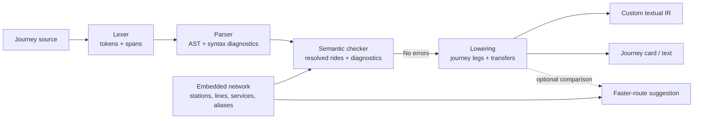

<div align="center">

# 🚇 Metro Journey Compiler

### A compiler for a small Delhi Metro journey language

**Write a journey. Inspect each compiler stage. Explore the route.**


[Get started](#-getting-started) · [Language](#-the-journey-language) · [Compiler pipeline](#-compiler-pipeline) · [Project structure](#-project-structure) · [Testing](#-testing)

</div>

---

## 📍 Overview

The **Metro Journey Compiler** turns a small, domain-specific language into a checked Delhi Metro journey. It applies compiler concepts to a practical problem: a traveller writes `board`, `ride`, `change`, and `exit` statements, and the application checks whether those instructions make sense on its embedded Metro network.

The browser playground updates as you type. It presents tokens, an abstract syntax tree (AST), diagnostics, a custom intermediate representation (IR), and a journey card with stops, transfers, and estimated travel time. A route planner can also write a journey program for two selected stations.

```text
board Rajiv Chowk;
ride Yellow to Hauz Khas;
change Magenta;
ride to Botanical Garden;
exit
```

> [!IMPORTANT]
> The network and travel times are **estimates based on a hand-entered snapshot**, not live DMRC data. Check the current official Metro information before planning a real journey.

## ✨ Features

- **Live compilation:** edit a program and immediately see updated results and diagnostics.
- **Compiler views:** explore tokens with source locations, the AST, and a lowered instruction-style IR.
- **Semantic journey checks:** catch unknown stations and lines, invalid line changes, unreachable destinations, and branch-service conflicts.
- **Helpful diagnostics:** inspect error locations, explanations, spelling suggestions, and one-click fixes where available.
- **Journey card:** view the route, intermediate stations, train direction, stops, transfers, and estimated time; copy the card as text.
- **Route planning:** generate a program using a shortest-time search over the embedded network; receive an optional faster-route suggestion for suitable valid journeys.
- **Editor conveniences:** syntax highlighting, completions, examples, shareable source links, dark mode, and locally saved source and theme preferences.
- **Network explorer:** browse the included lines and stations and insert station names into the editor.

## 🧰 Technology stack

| Area | Technology |
| --- | --- |
| Compiler and interface | TypeScript, HTML, CSS |
| Development server and bundler | Vite |
| Tests | Vitest |
| Runtime | Modern web browser; Node.js and npm for development and builds |

The compiler runs in the browser using the bundled network data. It does not require a backend, database, API key, or live AI service to compile a journey.

## 🚀 Getting started

### Prerequisites

- **Node.js 24** and its accompanying npm installation are recommended. The installed Vite and Vitest versions also support Node.js 22.12 or later in the 22.x series and Node.js 26 or later.
- A modern browser.
- A local copy of this project. If you have a GitHub repository URL, clone it using `git clone <repository-url>`; otherwise, extract the project archive or use the existing project folder.

Check the installed versions:

```bash
node --version
npm --version
```

### Install and run

From a terminal, enter the project directory and install the locked dependencies:

```bash
cd Delhi_Metro_Journey_Compiler
npm ci
npm run dev
```

Open the local URL printed by Vite, normally **http://localhost:5173**. Select an example or enter a program, then explore the output tabs.

> [!TIP]
> Run these commands from the folder containing `package.json`. If port 5173 is occupied, Vite may print a different local URL.

### Available commands

| Command | Purpose |
| --- | --- |
| `npm ci` | Install dependencies from `package-lock.json`. |
| `npm run dev` | Start the local development server. |
| `npm run typecheck` | Check TypeScript types without emitting files. |
| `npm test` | Run the Vitest compiler test suite once. |
| `npm run build` | Type-check and build the static application into `dist/`. |
| `npm run preview` | Serve an existing production build locally for preview. |

To preview the production build:

```bash
npm run build
npm run preview
```

Open the URL printed by Vite. The `dist/` directory can be deployed to a static host; Vite is configured with a relative base path for subdirectory hosting. `dist/` and `node_modules/` are generated locally and excluded from Git.

## 🕹️ Using the playground

1. **Enter a program** in the editor, or choose an entry from **Examples**.
2. **Review Problems** for errors, warnings, and suggestions. Click a diagnostic to locate it or use a fix button when one is offered.
3. **Inspect the compiler output:**
   - **Journey card** shows the route and time estimate.
   - **Tokens** shows token type, value, and source position.
   - **AST** shows the parsed program and source spans.
   - **IR** shows the lowered instructions for a valid journey.
   - **Network** lists the embedded lines, services, and stations used for name resolution.
4. **Try the route planner:** choose an origin and destination, then select **Write program** to replace the editor content with a suggested route.
5. Use **Share** to copy a link containing the source program, or **Copy as text** on the journey card.

> [!NOTE]
> When an edit introduces an error, the journey card may show the **last valid journey**, clearly marked as stale. The IR is only generated for the current program after it passes the checks.

## 📝 The journey language

### Statements

| Syntax | Meaning |
| --- | --- |
| `board <station>` | Start at a station. A journey must begin with one `board`. |
| `ride <line> to <station>` | Travel on the specified line to a destination station. |
| `ride to <station>` | Continue on the current line. On the first ride, the line can be inferred only when the boarding station has one line. |
| `change <line>` | Switch to another line at a valid interchange. |
| `exit` | Finish the journey at the current station. |

Statements are separated by a semicolon or a newline. A `#` starts a comment through the end of the line. Keywords are case-insensitive; station and line lookup ignores case, spaces, and punctuation and accepts selected aliases such as `CP`, `INA`, and `T3`.

```text
# Travel from Old Delhi to the airport
board Chandni Chowk
ride Yellow to New Delhi
change Airport Express
ride to IGI Airport
exit
```

A compact version of the parser's grammar is:

```ebnf
program   = statement, { separator, statement }, [ separator ] ;
statement = "board", name
          | "ride", [ name ], "to", name
          | "change", name
          | "exit" ;
name      = word, { word } ;
separator = ";" | newline ;
```

The parser also tolerates repeated or leading separators and ignores comments. Semantic rules impose additional constraints beyond this grammar.

### Try an invalid journey

```text
board Rajiv Chowk;
ride Yellow to Botanical Garden;
exit
```

Botanical Garden is not on the Yellow Line in the embedded network. The compiler reports **E208**, identifies the destination, and can offer a replacement route. Correcting the error allows the current journey and IR to be generated.

## ⚙️ Compiler pipeline



| Phase | What happens | Where to inspect it |
| --- | --- | --- |
| **Lexical analysis** | The lexer recognizes keywords, words, separators, comments, and end-of-file, recording source spans. | Tokens tab · `src/compiler/lexer.ts` |
| **Syntax analysis** | A recursive-descent parser constructs statements and a program AST, reporting and recovering from syntax errors. | AST and Problems · `src/compiler/parser.ts`, `ast.ts` |
| **Semantic analysis** | The checker resolves names against the network and tracks the current station and line while validating journey rules. | Problems and Network · `src/compiler/checker.ts`, `network.ts` |
| **Lowering and IR** | Validated rides become journey legs and transfers; a renderer expresses them as `BOARD`, `RIDE`, `XFER`/`TRAIN`, and `EXIT` instructions. | IR tab · `src/compiler/lower.ts`, `render-text.ts` |
| **Output generation** | The lowered journey is rendered as an interactive journey card and copyable text. | Journey card · `src/ui/card.ts`, `src/compiler/render-text.ts` |
| **Route suggestion** | Dijkstra's algorithm searches service-and-station states using the project's estimated time costs. A valid journey receives an optional suggestion if the modeled saving is at least five minutes. | Route planner and Problems · `src/compiler/network.ts`, `index.ts` |

> [!NOTE]
> The network acts as the compiler's domain lookup table for stations, lines, aliases, and services. The Network tab displays this data, but there is no separate per-program symbol-table or semantic-state visualization. Faster-route suggestions are optional; there is no separate automatic IR optimization pass. The output is a domain-specific journey representation, not machine code.

### Diagnostics

| Category | Examples |
| --- | --- |
| `E1xx` · Syntax errors | Missing station or separator, missing `to`, unknown command, unexpected input. |
| `E2xx` · Semantic errors | Unknown names, invalid journey order, invalid line change, station not on line, or no direct train across branches. |
| `W3xx` · Warnings | A journey doubles back, changes to a line without riding it, or exits without a ride. |
| `I4xx` · Information | A modeled faster route is available. |

Diagnostics carry source spans; many include contextual help and an applicable edit. The parser and checker try to continue after errors to provide useful feedback without excessive cascading messages.

## 🗺️ Network and time model

The embedded dataset includes **Red, Yellow, Blue, Green, Violet, Pink, Magenta, Airport Express, and Grey** lines. Blue and Green branches are represented as separate services, allowing the checker to identify journeys that need a train change at a junction. A station shared by two or more included lines is treated as an interchange. Aqua and Rapid Metro are not included.

The estimate uses:

| Component | Estimated time |
| --- | ---: |
| Initial wait, when the journey has a ride | 3 minutes |
| Most lines | 2.2 minutes per stop |
| Airport Express | 4.5 minutes per stop |
| Grey Line | 2.5 minutes per stop |
| Change between lines | 5 minutes |
| Change trains on the same line | 4 minutes |

Actual schedules, station availability, walking times, service patterns, and operating conditions are not modeled. Network data is maintained in `src/compiler/network-data.ts`; time constants and route search are in `src/compiler/network.ts`.

## 🗂️ Project structure

```text
Delhi_Metro_Journey_Compiler/
├── index.html                  # Playground layout and application entry point
├── package.json                # Dependencies and npm scripts
├── package-lock.json           # Locked dependency tree
├── tsconfig.json               # TypeScript compiler options
├── vite.config.ts              # Vite configuration and relative base path
├── src/
│   ├── compiler/
│   │   ├── index.ts            # Orchestrates compilation and route suggestions
│   │   ├── lexer.ts            # Source → tokens
│   │   ├── parser.ts           # Tokens → AST and syntax diagnostics
│   │   ├── ast.ts              # AST node and name types
│   │   ├── checker.ts          # Semantic validation and name resolution
│   │   ├── diagnostics.ts      # Diagnostics, source positions, and fixes
│   │   ├── network-data.ts     # Lines, station lists, services, and aliases
│   │   ├── network.ts          # Network model, lookup, and route planning
│   │   ├── lower.ts            # Resolved rides → journey representation
│   │   └── render-text.ts      # Textual IR and copyable journey output
│   └── ui/
│       ├── main.ts             # Editor, live compilation, tabs, and interactions
│       ├── views.ts            # Token, AST, and network views
│       ├── card.ts             # Journey card rendering
│       ├── completions.ts      # Context-aware editor completions
│       ├── highlight.ts        # Syntax and diagnostic highlighting
│       ├── examples.ts         # Sample journey programs
│       ├── html.ts             # HTML escaping and display helpers
│       └── styles.css          # Layout, component styling, and themes
└── tests/
    └── compiler.test.ts        # Compiler, network, diagnostics, and journey tests
```

## 🧪 Testing

```bash
npm run typecheck
npm test
npm run build
```

The test suite includes examples of tokenization, parsing and recovery, name resolution, journey structure, invalid interchanges, branch services, suggested fixes, and expected journey output. These checks are useful for regression detection; they do not independently prove that the complete real-world network is current or that every possible input is handled correctly.

> [!TIP]
> If Vite or Vitest reports a missing or rejected native Rolldown binding, check the Node.js version and operating-system security policy, then reinstall dependencies with `npm ci`. A fresh installation and build should be verified on the machine used for evaluation.

## ⚠️ Known limitations and future work

- The embedded network is a manually maintained snapshot and does not provide live service or timetable information.
- Name normalization removes punctuation, so unexpected punctuation in a station or line name may be accepted instead of reported as a lexical error.
- Semantic resolution is reflected in diagnostics and the network view, but a dedicated per-program symbol table and phase-by-phase semantic state are not yet displayed.
- The faster-route recommendation is not an automatic optimization pass, and the project does not generate machine code or multiple target formats.
- Future work could improve lexical validation, add semantic and optimization visualizations, expand and update the network, and support additional output targets.

---

<div align="center">
  Built to explore compiler design through Delhi Metro journeys 🚇
</div>
